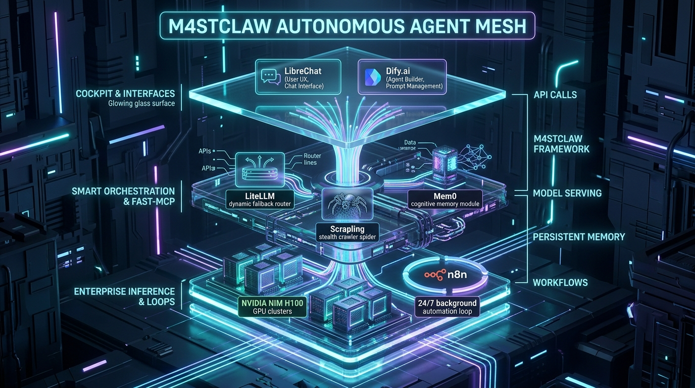
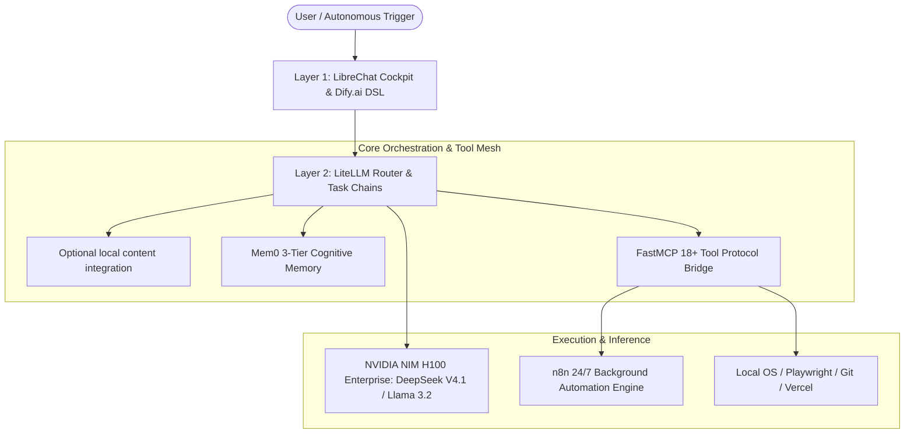

<div align="center">

# ⚡ M4STCLAW v5.0 — Bahubali Autonomous Agent OS
### Local dashboard, agent coordination, and multi-provider model routing

[](https://github.com/m4stanuj/M4STCLAW/releases/tag/v5.0.0)
[-0078D6?style=for-the-badge&logo=windows)](https://github.com/m4stanuj/M4STCLAW/releases/download/v5.0.0/m4stclaw-v5.0.0-windows-x64.zip)
[](https://build.nvidia.com)
[](https://modelcontextprotocol.io)
[](LICENSE)

<br/>


<br/>

**M4STCLAW** is a local AI workspace by **Mast Anuj ([@m4stanuj](https://github.com/m4stanuj))**. The source distribution includes model routing, memory, a local dashboard, and separate integration components. Provider availability and pricing depend on your own credentials and plan.

[Quick Start](#-quick-start) • [Architecture](#-system-architecture) • [Network defaults](#network-defaults)

</div>

---

## 🏛️ System Architecture

M4STCLAW is engineered with a modular 3-tier reactive hierarchy:

<div align="center">

</div>



---

## ⚔️ M4STCLAW vs. Top 15 AI Repos

How M4STCLAW synthesizes and transcends the capabilities of the #1 trending repositories on GitHub:

| Capability | Scrapling / Crawl4AI | Browser-Use | Mem0 | LiteLLM | FastMCP | **M4STCLAW v5.0 (Bahubali)** |
| :--- | :---: | :---: | :---: | :---: | :---: | :---: |
| **Zero-Cost Live Web Search** | ❌ | ❌ | ❌ | ❌ | ❌ | **✅ Built-in (Ad-free organic parsing)** |
| **3-Tier Cognitive Memory** | ❌ | ❌ | ✅ | ❌ | ❌ | **✅ Working → Episodic → Semantic (TF-IDF + Vector)** |
| **Multi-Provider Fallback Routing** | ❌ | ❌ | ❌ | ✅ | ❌ | **✅ 9 Chains across NVIDIA H100, Groq, Cerebras** |
| **MCP Native Protocol Support** | ❌ | ❌ | ❌ | ❌ | ✅ | **✅ Native FastMCP with 18+ agentic tools** |
| **24/7 Background Automation** | ❌ | ❌ | ❌ | ❌ | ❌ | **✅ Integrated n8n autonomous webhook loops** |
| **Single Portable Windows Binary** | ❌ | ❌ | ❌ | ❌ | ❌ | **✅ `m4stclaw.exe` (Zero Node/Python required)** |

---

## ⚡ Quick Start

For the Python dashboard, install the project with `python -m pip install -e .`. Generate a dashboard token with `python -c "import secrets; print(secrets.token_urlsafe(32))"`, store it as `M4STCLAW_API_TOKEN` in the process environment or the dashboard configuration directory's `.env`, then run `python start.py`. Open `http://127.0.0.1:8000` and enter the token in the sidebar. Docker Compose reads the token from the project `.env`.

### Build the Windows dashboard preview from source

From the repository root in PowerShell on Windows x64, use a Python 3.11 x64 virtual environment.

```powershell
python -m pip install . pyinstaller==6.22.3 pywin32==312
./scripts/build-windows.ps1
python scripts/smoke-windows.py build/windows/M4STCLAW.exe
```

The preview bundles the Python runtime and dashboard assets. Double-click `build\windows\M4STCLAW.exe` to open the local dashboard in your browser. On a fresh profile, paste the session token shown in the console into the dashboard's **Dashboard token** field. That token expires when you close the EXE. If you already set a valid token, enter your existing token. Scripted launches with redirected output require a configured token. The build produces an unsigned local preview.

### 1. Download Standalone Executable (Windows x64)
No Node.js, Python, or Docker required!
- Download the latest standalone release: **[m4stclaw-v5.0.0-windows-x64.zip](https://github.com/m4stanuj/M4STCLAW/releases/download/v5.0.0/m4stclaw-v5.0.0-windows-x64.zip)**
- Extract and launch:
  ```powershell
  .\m4stclaw.exe
  ```

### 2. Configure Environment (Optional)
Create a `.env` file in the same directory:
```bash
cp .env.template .env
```
```env
# Optional: Use your custom NVIDIA NIM key (Get free at https://build.nvidia.com)
NVIDIA_API_KEY=nvapi-your-key-here
```

### 3. Interactive CLI Commands
Inside `m4stclaw.exe`:
```text
M4STCLAW> search latest AI agent benchmarks 2026
M4STCLAW> scrape https://news.ycombinator.com
M4STCLAW> agent scrape competitor pricing and generate market summary
M4STCLAW> model vision
M4STCLAW> Describe the architecture diagram in ./assets/m4stclaw-architecture.jpg
```

<div align="center">

</div>

---

## Network defaults

The dashboard is intended for a trusted local machine. Docker Compose publishes port 8000 on loopback only. The dashboard does not mount the MCP tool server. Optional CLI integration addresses are configured explicitly and have no public defaults.

Dashboard run counts and durations are measured for the current server process. Provider rows show configuration and key cooldowns. They do not probe provider uptime or report billing.

---

## 🔒 Security & Code Compliance

All releases undergo automated security audits:
- **Zero Hardcoded Secrets**: Scanned via custom AST and regex leak detectors (`git ls-files`).
- **Safe Execution**: Command runners enforce strict argument serialization.
- **Air-Gapped Memory Fallback**: TF-IDF cosine similarity fallback when ChromaDB or external embeddings are unreachable.

---

## 👨‍💻 Author & Credits

- **Architect & Lead Developer:** Mast Anuj ([@m4stanuj](https://github.com/m4stanuj))
- **Inference Infrastructure:** NVIDIA NIM Enterprise Cloud (H100 Tensor Core)
- **Scraping Engine:** Powered by [Scrapling](https://github.com/D4Vinci/Scrapling) anti-detection core

---

<div align="center">
<b>M4STCLAW OS — Stay Unstoppable.</b>
</div>
