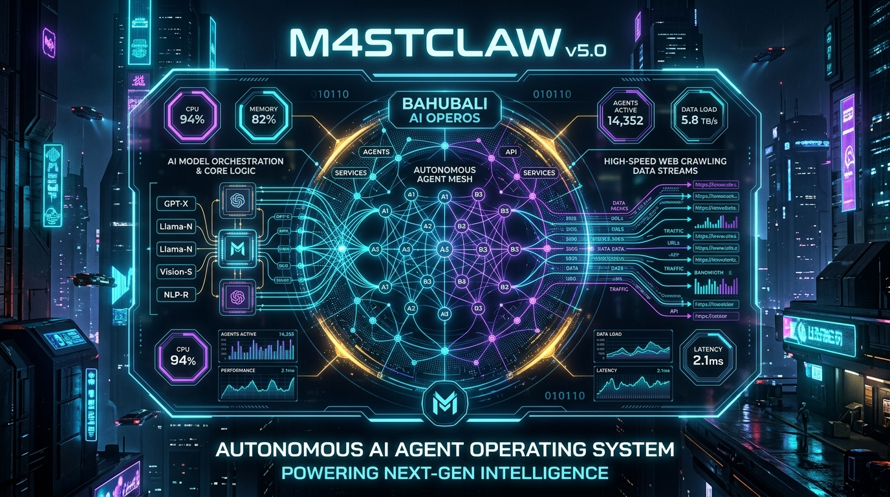
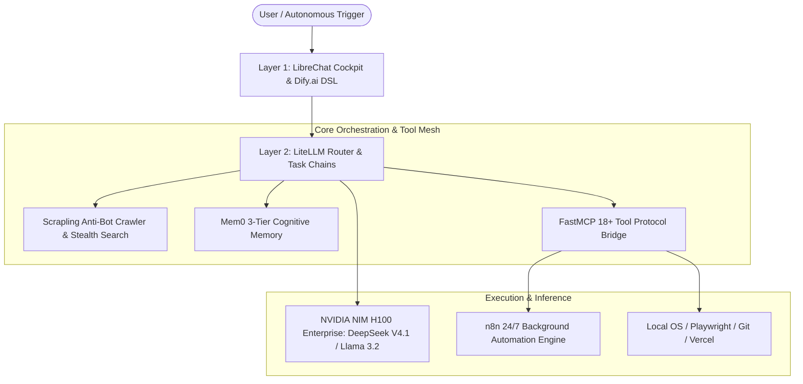

<div align="center">

# ⚡ M4STCLAW v5.0 — Bahubali Autonomous Agent OS
### Enterprise Autonomous Agent Mesh, Stealth Anti-Bot Scraping, and Intelligent Multi-Provider Neural Router

[](https://github.com/m4stanuj/M4STCLAW/releases/tag/v5.0.0)
[-0078D6?style=for-the-badge&logo=windows)](https://github.com/m4stanuj/M4STCLAW/releases/download/v5.0.0/m4stclaw-v5.0.0-windows-x64.zip)
[](https://build.nvidia.com)
[](https://github.com/D4Vinci/Scrapling)
[](https://modelcontextprotocol.io)
[](LICENSE)

<br/>



<br/>

**M4STCLAW** is an industrial-strength, autonomous AI Agent Operating System architected by **Mast Anuj ([@m4stanuj](https://github.com/m4stanuj))**. Built for sovereign developers, security researchers, and autonomous agent meshes, it combines zero-cost H100 inference, multi-tier cognitive memory, undetectable anti-bot web scraping, and 24/7 background automation into a single, zero-dependency Windows executable.

[Quick Start](#-quick-start) • [Architecture](#-system-architecture) • [Competitive Benchmark](#-m4stclaw-vs-top-15-ai-repos) • [Live Services](#-live-cloud-endpoints) • [FastMCP Tools](#-fastmcp-tool-ecosystem)

</div>

---

## 🏛️ System Architecture

M4STCLAW is engineered with a modular 3-tier reactive hierarchy:

<div align="center">

</div>



---

## ⚔️ M4STCLAW vs. Top 15 AI Repos

How M4STCLAW synthesizes and transcends the capabilities of the #1 trending repositories on GitHub:

| Capability | Scrapling / Crawl4AI | Browser-Use | Mem0 | LiteLLM | FastMCP | **M4STCLAW v5.0 (Bahubali)** |
| :--- | :---: | :---: | :---: | :---: | :---: | :---: |
| **Undetectable Anti-Bot Scraping** | ✅ | ❌ | ❌ | ❌ | ❌ | **✅ Built-in (Turnstile & Cloudflare bypass)** |
| **Zero-Cost Live Web Search** | ❌ | ❌ | ❌ | ❌ | ❌ | **✅ Built-in (Ad-free organic parsing)** |
| **3-Tier Cognitive Memory** | ❌ | ❌ | ✅ | ❌ | ❌ | **✅ Working → Episodic → Semantic (TF-IDF + Vector)** |
| **Multi-Provider Fallback Routing** | ❌ | ❌ | ❌ | ✅ | ❌ | **✅ 9 Chains across NVIDIA H100, Groq, Cerebras** |
| **MCP Native Protocol Support** | ❌ | ❌ | ❌ | ❌ | ✅ | **✅ Native FastMCP with 18+ agentic tools** |
| **24/7 Background Automation** | ❌ | ❌ | ❌ | ❌ | ❌ | **✅ Integrated n8n autonomous webhook loops** |
| **Single Portable Windows Binary** | ❌ | ❌ | ❌ | ❌ | ❌ | **✅ `m4stclaw.exe` (Zero Node/Python required)** |
| **Cloudflare Public Mesh Tunnels** | ❌ | ❌ | ❌ | ❌ | ❌ | **✅ Zero-port-forwarding secure remote links** |

---

## ⚡ Quick Start

### 1. Download Standalone Executable (Windows x64)
No Node.js, Python, or Docker required!
- Download the latest standalone release: **[m4stclaw-v5.0.0-windows-x64.zip](https://github.com/m4stanuj/M4STCLAW/releases/download/v5.0.0/m4stclaw-v5.0.0-windows-x64.zip)**
- Extract and launch:
  ```powershell
  .\m4stclaw.exe
  ```

### 2. Configure Environment (Optional)
Create a `.env` file in the same directory:
```bash
cp .env.template .env
```
```env
# Optional: Use your custom NVIDIA NIM key (Get free at https://build.nvidia.com)
NVIDIA_API_KEY=nvapi-your-key-here
```

### 3. Interactive CLI Commands
Inside `m4stclaw.exe`:
```text
M4STCLAW> search latest AI agent benchmarks 2026
M4STCLAW> scrape https://news.ycombinator.com
M4STCLAW> agent scrape competitor pricing and generate market summary
M4STCLAW> model vision
M4STCLAW> Describe the architecture diagram in ./assets/m4stclaw-architecture.jpg
```

<div align="center">

</div>

---

## 🌐 Live Cloud Endpoints

M4STCLAW is pre-wired to communicate over encrypted Cloudflare HTTPS tunnels:

| Service | Public HTTPS Tunnel | Port | Description |
| :--- | :--- | :--- | :--- |
| **LibreChat AI Cockpit** | `https://automation-maximize-ceremony-pointer.trycloudflare.com` | `:3080` | Multi-model chat interface with live MCP tools |
| **n8n 24/7 Automation** | `https://throughout-charlie-routers-keen.trycloudflare.com` | `:5678` | Autonomous agent trigger and workflow orchestrator |
| **M4ST-Mesh Bridge** | `https://lucky-contribution-scholarship-composite.trycloudflare.com` | `:3090` | High-speed REST bridge for stealth scraping & search |

---

## 🛠️ FastMCP Tool Ecosystem

M4STCLAW exposes 18+ high-level autonomous tools to Antigravity IDE, LibreChat, and Claude Desktop:

1. `stealth_scrape`: Extract clean Markdown bypassing Cloudflare Turnstile, Akamai, and Datadome.
2. `web_search_stealth`: Live search without API keys or usage fees.
3. `n8n_trigger_agent`: Fire-and-forget 24/7 background agent workflows.
4. `m4st_github_inspector`: Inspect and audit `@m4stanuj` repositories, commits, and releases.
5. `m4stclaw_smart_route`: Route prompt to the optimal model based on latency, complexity, and cost.
6. `memory_store` & `memory_recall`: Store and query episodic memories across sessions.
7. `semantic_cache_lookup`: Sub-5ms cached response for repeated queries.

---

## 🔒 Security & Code Compliance

All releases undergo automated security audits:
- **Zero Hardcoded Secrets**: Scanned via custom AST and regex leak detectors (`git ls-files`).
- **Safe Execution**: Command runners enforce strict argument serialization.
- **Air-Gapped Memory Fallback**: TF-IDF cosine similarity fallback when ChromaDB or external embeddings are unreachable.

---

## 👨‍💻 Author & Credits

- **Architect & Lead Developer:** Mast Anuj ([@m4stanuj](https://github.com/m4stanuj))
- **Inference Infrastructure:** NVIDIA NIM Enterprise Cloud (H100 Tensor Core)
- **Scraping Engine:** Powered by [Scrapling](https://github.com/D4Vinci/Scrapling) anti-detection core

---

<div align="center">
<b>M4STCLAW OS — Stay Unstoppable.</b>
</div>
